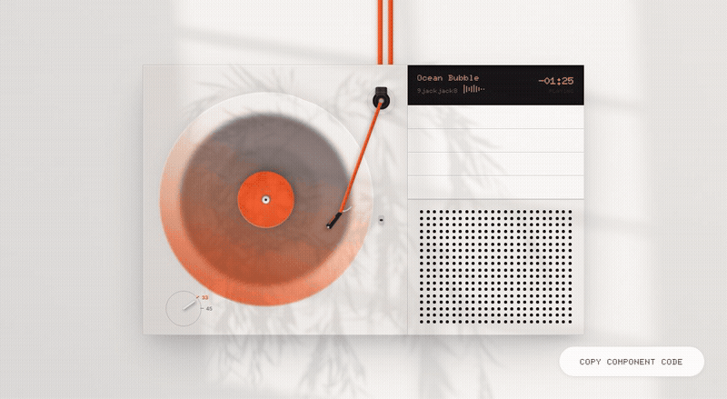

# LP Player - Interactive Minimalist Turntable

An aesthetic, Dieter Rams and Braun-inspired interactive turntable component built with React, Vite, and Framer Motion. Designed as a self-contained, single-file drop-in component so developers can copy, paste, and embed a tactile music player directly into their applications.

---

## Preview



---

## Live Demo

Experience the interactive player live at [lp-player-beta.vercel.app](https://lp-player-beta.vercel.app/).

---

## Features and Tactile Interactions

1. Translucent Frosted Glass Vinyl:
   - Oversized circular translucent glassmorphic platter extending past chassis borders with frosted glassmorphism.
   - Concentric charcoal grooves, specular sheen reflection, and warm orange center supporter.
   - Smooth continuous rotation during playback.
2. Centered Fixed Deck Pivot and Rotating Tonearm:
   - Stationary circular gimbal housing, metallic counterweight, and silver bearing center pin fixed on the deck.
   - Orange tonearm wand rotates fluidly around the fixed pivot center using Framer Motion spring physics.
   - Swipe or flick gestures: swipe left towards the record to cue and play; swipe right towards the rest cradle to stop. Clicking the arm or vinyl also toggles playback.
3. Dieter Rams 33 and 45 RPM Speed Selector Knob:
   - Hairline dial ring with tactile radial pointer lever.
   - Station positions for 33 and 45 RPM that dynamically adjust vinyl rotation speed and audio playback rate.
4. Skeuomorphic Volume Slats:
   - Clean, text-free mechanical white bars with soft top highlights and drop shadows.
   - 4 stepped tactile volume levels (100%, 75%, 50%, 25%) with physical click feedback.
5. Perforated Industrial Speaker Grille:
   - Precision 24 column by 18 row circular perforated acoustic grille panel.
6. Procedural Web Audio API Sound Synthesis:
   - Analog needle drop thud and surface crackle synthesized on the fly via the browser's native AudioContext with zero external audio assets required.
7. Self-Contained Drop-In Architecture:
   - All component styling is encapsulated directly within the component. No global CSS or configuration required.

---

## Copy-Paste Usage

### 1. Install Dependency

The component requires only Framer Motion for spring physics and gestures:

```bash
npm install framer-motion
```

### 2. Copy Component File

Copy `LPPlayer.tsx` from `src/components/LPPlayer.tsx` into your project.

### 3. Embed the Component

```tsx
import React from 'react';
import LPPlayer from './components/LPPlayer';

export default function AudioPage() {
  return (
    <main style={{ minHeight: '100vh', display: 'flex', alignItems: 'center', justifyContent: 'center', background: '#faf8f5' }}>
      <LPPlayer
        audioSrc="/audio/ocean-bubbles.mp3"
        trackName="Ocean Bubble"
        artist="9jackjack8"
      />
    </main>
  );
}
```

---

## Music and Asset Credits

- Audio Track: Ocean Bubbles (Frutiger Aqua Game) by 9jackjack8. Licensed under Pixabay Content License (Free for commercial and non-commercial use). Source: [Pixabay - Ocean Bubbles](https://pixabay.com/music/ambient-ocean-bubbles-frutiger-aqua-game-550245/).
- Design Philosophy: Dieter Rams industrial minimalism and Braun audio equipment.

---

## License

MIT License. Free to use, modify, and distribute.
