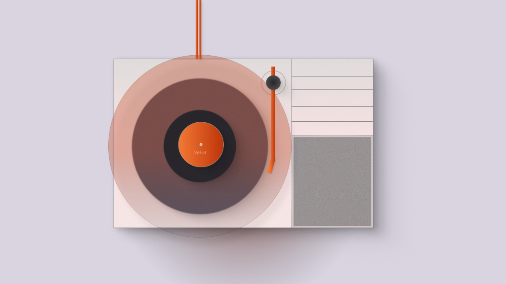

# 🎵 Vel-vt LP Player — Interactive Minimalist Turntable

An aesthetic, Dieter Rams & Braun-inspired interactive turntable component built with **React**, **Vite**, and **Framer Motion**. Designed for drop-in usability so developers can copy, paste, and embed a tactile music player directly into their applications.

---

## 🎨 Figma Design Reference



*Design origin: [Figma — Vel-new-thumbnail](https://www.figma.com/design/64qmcf8qbAG8YTrwIFDDKr/Vel-new-thumbnail?node-id=1-2&t=SNxE9YoLHo1mKTyl-4).*

---

## 🚀 Live Product Demo

- **Local Preview**: [http://localhost:5175/](http://localhost:5175/)
- **Vercel Deploy**: Ready for 1-click deployment with `vercel` CLI or Git integration.

---

## ✨ Features & Tactile Interactions

1. **Pixel-Perfect Translucent Coral-Peach Vinyl**:
   - Oversized circular translucent glassmorphic disc extending slightly past the chassis edges, exactly matching the Figma design.
   - Concentric dark charcoal rings, concentric grooves, and orange "Vel-vt" center label with spindle hole.
   - Smooth continuous linear rotation when playing; halts smoothly when paused.
2. **Fixed Deck Pivot & Rotating Stylus Arm**:
   - Stationary circular pivot housing fixed in place on the deck.
   - Orange stylus arm rotates fluidly around the pivot center using Framer Motion spring physics.
   - Direct click or drag on the arm to drop the needle and cue playback.
3. **5 White Skeuomorphic Volume Slats**:
   - Clean, text-free mechanical white bars with soft top highlights and realistic bottom drop shadows.
   - Acts as 5 stepped tactile volume faders (top to bottom: 100%, 80%, 60%, 40%, 20%) with physical push-in depression.
4. **Procedural Web Audio API Sound Synthesis**:
   - Authentic analog needle drop "thud/pop" and surface crackle synthesized on the fly via the browser's native `AudioContext` (0KB extra asset download, 100% copyright-free).
5. **Static Acoustic Fabric Speaker Grille**:
   - Textured grey acoustic felt panel on bottom right, matching the industrial reference without artificial motion.
6. **GlassButton Component**:
   - Integrated custom glassmorphic button for copying component code and opening documentation.

---

## 📦 Copy-Paste Usage

### 1. Install Dependencies

```bash
npm install framer-motion class-variance-authority lucide-react
```

### 2. Copy Component Files

Copy [`src/components/LPPlayer.tsx`](src/components/LPPlayer.tsx) and [`src/utils/vinylAudio.ts`](src/utils/vinylAudio.ts) into your project.

### 3. Embed the Component

```tsx
import React from 'react';
import LPPlayer from './components/LPPlayer';

export default function AudioPage() {
  return (
    <LPPlayer
      audioSrc="/audio/ocean-bubbles.mp3"
    />
  );
}
```

---

## 🧪 Testing Interactive Components

```bash
npm test
```

- **Playback Volume Steps**: Validates 5 discrete volume ratios (100% to 20%).
- **Time Formatting & Assets**: Asserts audio track and build outputs.
- **Manual Checks**:
  - Click vinyl or tonearm to drop the needle and hear the Web Audio thud.
  - Press any of the 5 white slats to adjust volume with mechanical tactile depression.

---

## 🎵 Music & Asset Credits

- **Audio Track**: *Ocean Bubbles (Frutiger Aqua Game)* by **9jackjack8**.  
  Licensed under Pixabay Content License (Free for commercial and non-commercial use).  
  Source: [Pixabay — Ocean Bubbles](https://pixabay.com/music/ambient-ocean-bubbles-frutiger-aqua-game-550245/)
- **Design Philosophy**: Built in strict adherence to [Dietrich Gebert's Ponytail](https://github.com/dietrichgebert/ponytail) (*"The best code is the code never written. He says nothing. He writes one line. It works."*).

---

## 📄 License

MIT License. Free to use, modify, and distribute.
